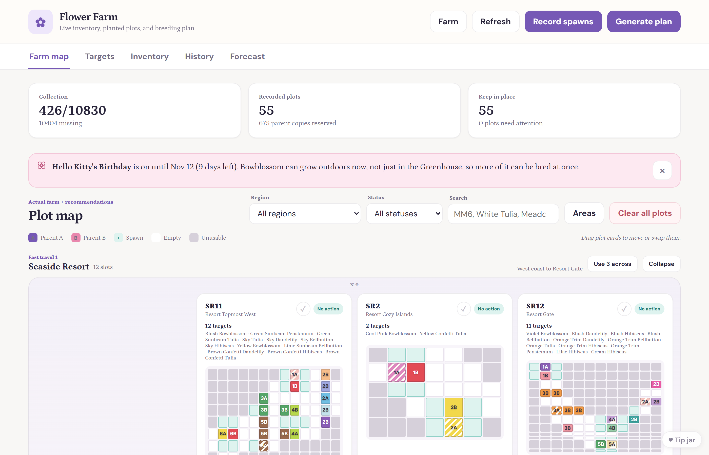
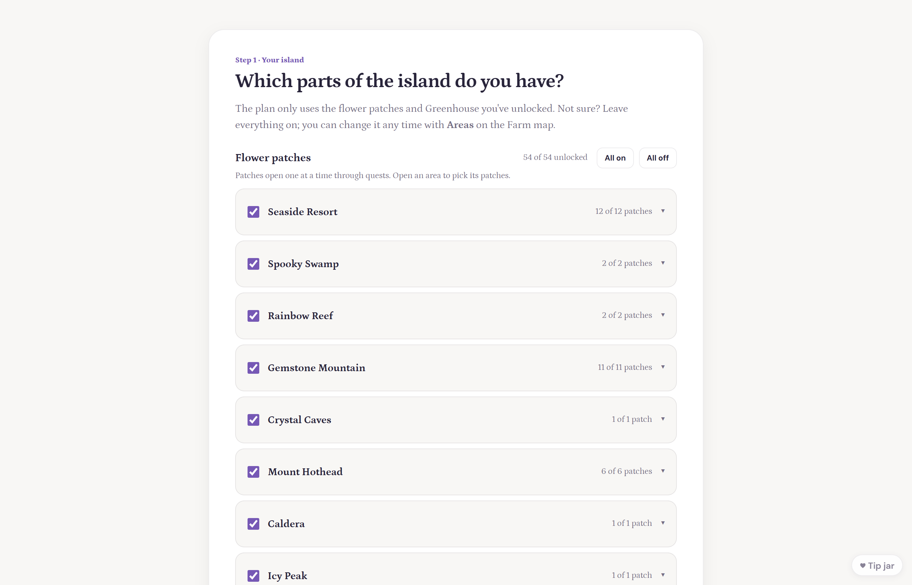
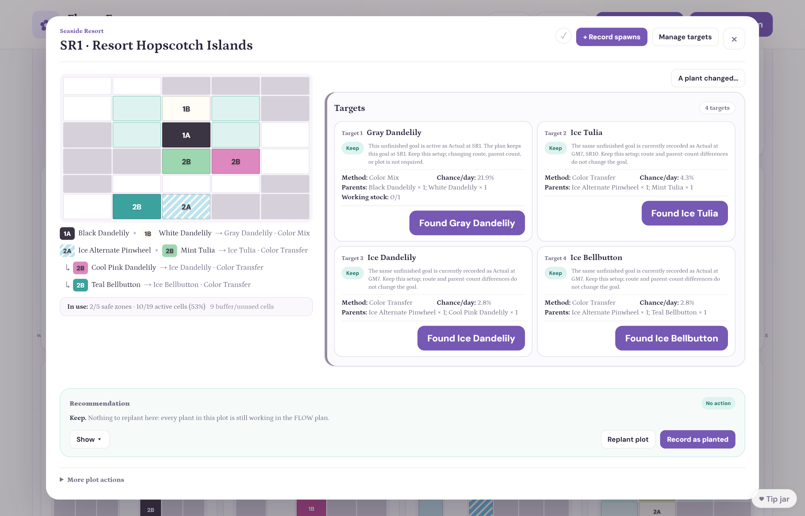
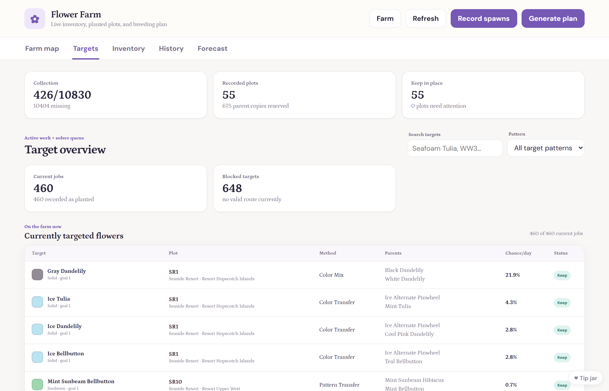
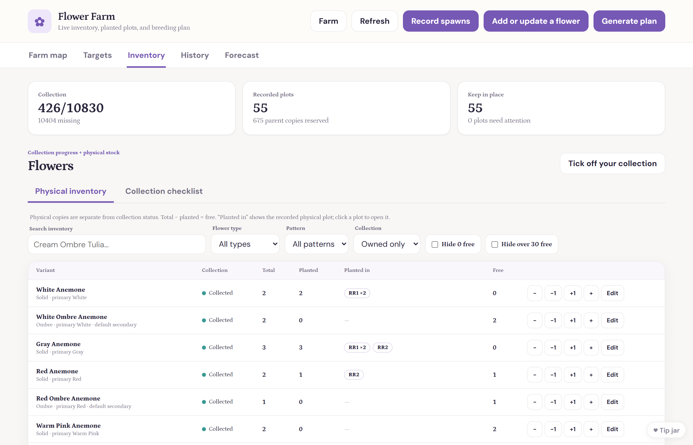
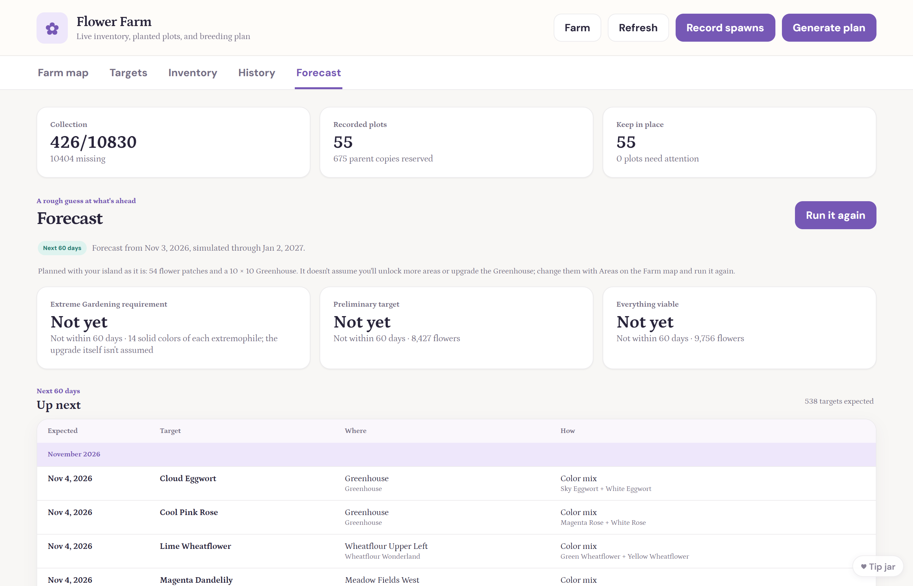
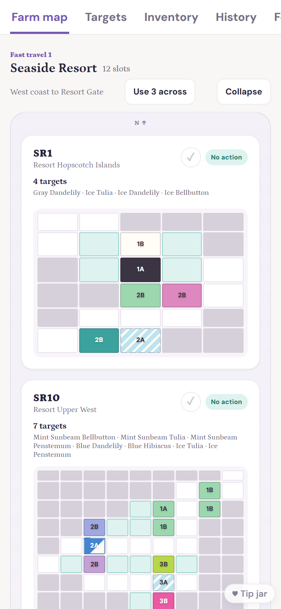

# HKIA Flower Planner

A planner for the flower collection in *Hello Kitty Island Adventure*: tell it
which parts of the island you've unlocked and which flowers you have, and it
works out what to plant where to finish your collection faster. It runs
entirely in your browser; your farm is saved only on your device.

**Open it: https://danleizsf.github.io/hkia-flower-planner-site/**

*Screenshots show a demo farm: 426 flowers, every area unlocked, a 10 × 10 Greenhouse.*

This repository only holds the built site. A fan-made tool, not affiliated
with Sanrio or Sunblink.

## What it does

### Getting started in a few minutes

- **Your island as it is.** Pick the areas and flower patches you've unlocked
  and your Greenhouse size. The plan only ever uses what you have, and you can
  change it later with **Areas** when you unlock more.
- **Your seeds and plants.** Tick what's in your in-game inventory using the
  same filters as the game (color, flower type, pattern) and type how many
  you have. Skip it and finish later if you like.
- **A guided first plan.** The first plan shows its progress as it works, and
  a short getting-started checklist walks you through planting, recording
  spawns and your first find.

### Farm planning

- **The whole farm at once.** Every patch gets its targets and the exact cells
  for each parent: **A** and **B** mark the two parents of a cross, and the
  dotted cells are where new flowers can spawn.
- **Step-by-step planting guides.** Open a patch to see which flowers to plant
  where, grouped by the in-game filters you'll use, with row and column for
  each one.
- **The Greenhouse** gets one shared layout that packs several crosses
  together.
- **Every target explained:** its method (color transfer, pattern transfer,
  color mix or fertilizer), its parents and its chance of spawning each day.

### Strategy built in

**The goal is your whole collection, as soon as possible.** The planner doesn't
just pick today's easiest finds; it chooses the crosses that shorten the road
to a full collection:

- **Flowers that open doors come first.** A new solid color is worth more the
  more patterns it unlocks, so the planner breeds the colors that make the most
  other targets possible.
- **Chance per day counts.** Crosses with a better daily spawn chance are
  preferred, so patches spend their days on likely finds.
- **The Greenhouse is saved for what only it can grow,** like extremophiles
  and out-of-season event flowers (more so as their event gets close). Anything
  the outdoor patches can grow stays outside, so no space is wasted.
- **Seasonal windows aren't missed.** During an event the planner moves that
  event's flowers outdoors while they can grow there, and spreads them over
  more patches because the window is short. A banner tells you what's in
  season and for how long.

And it stays practical day to day:

- **Keeps what's working.** A new plan keeps patches whose plants are still
  working toward a goal and only changes the ones that need it, so you replant
  as little as possible.
- **Counts real copies.** Parents are only planned from copies you actually
  have free, and planted copies are reserved for their patch.
- **Honest about what's out of reach.** Targets with no route yet (for
  example, an event flower you have none of) are listed as blocked rather than
  planned anyway.

### Tracking progress

- **Record spawns** after you play: the planner updates your copies and marks
  a target found when it shows up.
- **Found it** buttons on each target, and **A plant changed** for when the
  game surprises you.
- **Daily checks** on each patch, which clear at the game's daily reset.
- **History:** your collection over time and the new flowers you found each
  day.

### Inventory and collection

- **Physical inventory:** how many of each flower you have, how many are
  planted and where, and how many are free.
- **Collection checklist:** what you've collected, browsed the same way as the
  game.

### Forecast

A rough guess at the next 60 days: it plays your plan forward, rolling the
dice for each flower like the game does, to show which flowers you'll likely get and roughly when, and which event
windows matter for your flowers. It uses your island as it is and doesn't
assume you'll unlock or upgrade anything.

### Your data stays yours

- Everything runs in your browser; nothing is uploaded.
- **Download a backup** of your farm from the Farm menu, restore it on another
  device, and undo a restore if you picked the wrong file.

### Works on phones

## What's new

See the [changelog](CHANGELOG.md) for what changed in each update (also under
**What's new** on the farm map).

## Feedback

Found a bug or have an idea? Use **Feedback** on the farm map (no account
needed), or [open an issue](https://github.com/danleizsf/hkia-flower-planner-site/issues/new/choose) here.

## Credits

- Plot shapes and blocked cells (`data/plot_layouts.json` in `app.zip`) and
  which patterns each flower type can have (`data/pattern_compatibility.json`)
  come from [hkiaflowergen](https://flowerfulpowerful.github.io/hkiaflowergen/)
  ([GitHub](https://github.com/flowerfulpowerful/hkiaflowergen)) by
  Auevi (Vi) & contributors. No code was taken from it.
- Where each flower type grows and how breeding works follow the
  [Hello Kitty Island Adventure Wiki](https://hellokittyislandadventure.wiki.gg/),
  cross-checked against hkiaflowergen's flower data.

Thank you to both!

Built with help from [Claude Code](https://www.anthropic.com/claude-code), an AI coding assistant.

## License

Copyright (C) 2026 danleizsf

The planner (its code: the web files and the Python in `app.zip`) is free
software under the [GNU Affero General Public License v3.0](LICENSE): you may
use, study, share and change it, and anyone who shares a copy or runs a
changed version for others must offer its full source under the same license.

The flower data credited above comes from those projects and stays under
their terms. Hello Kitty and the game belong to Sanrio and Sunblink.
